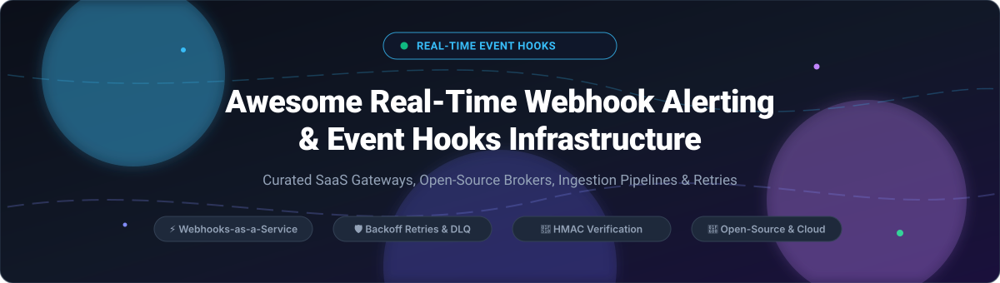

  

# Awesome Real-Time Webhook Alerting & Event Hooks

    

> ⚡ A curated collection of top **Real-Time Webhook Alerting and Event Hook platforms** — including enterprise SaaS solutions, webhook-as-a-service providers, event gateways, and open-source infrastructure for reliably ingesting, routing, verifying, retrying, and delivering webhook events across modern distributed systems.

🌟 **Star this repository if you find it useful!** 🌟

---

## 📋 Table of Contents

- [🌐 Sector Overview & Market Dynamics](#-sector-overview--market-dynamics)
- [🟦 SaaS & Hosted Webhook Platforms](#-saas--hosted-webhook-platforms)
- [🟩 Open-Source Webhook Infrastructure](#-open-source-webhook-infrastructure)
- [📊 Comparison Matrix](#-comparison-matrix)
- [📈 Star History](#-star-history)
- [💖 Support](#-support)
- [🤝 Contributing](#-contributing)
- [📄 License](#-license)

---

## 🌐 Sector Overview & Market Dynamics

The global **Event-Driven Architecture (EDA) & Webhook Management** market is valued at approximately **$3.7B – $8.2B** (with the broader Integration Platform-as-a-Service / iPaaS ecosystem surpassing **$28B**) and is projected to expand to **$31.5B+ by 2032** at an 18%+ CAGR. 🚀

The sector remains **moderately fragmented**: general-purpose enterprise iPaaS and no-code automation giants dominate broad workflow orchestration, while specialized developer-centric **Webhook-as-a-Service (WaaS)** and low-latency API event gateway layers are contested by fast-moving niche platforms competing on delivery guarantees, end-to-end security, and self-hosted open-source control. ⚖️

---

## 🟦 SaaS & Hosted Webhook Platforms

Commercial, cloud-hosted webhook alerting, event routing, and delivery platforms. Sorted descending by company size (valuation / revenue): 🏢

| Platform | Company Valuation / Revenue | Starting Price | Free Tier Limits / Trial | Core Capabilities & Best For |
|---|---|---|---|---|
| **[Make (Celonis)](https://www.make.com/)** | Valued at **$13B** (Parent Celonis; Make ARR ~$50M+) 📈 | **$9.00/mo** (billed annually) / $10.59/mo (monthly) 💳 | **1,000 credits/mo**, 2 active scenarios, 15-minute minimum interval, 5 MB file execution limit 🎁 | Visual webhook-driven scenario orchestration, incoming mailhooks/webhooks, payload validation, and multi-step routing. 🔀 |
| **[Zapier](https://zapier.com/)** | Valued at **$5.0B** (~$310M+ ARR) 📈 | **$19.99/mo** (billed annually for 750 tasks) / $29.99/mo (monthly) 💳 | **100 tasks/mo**, single-user, 2-step Zaps (1 trigger + 1 action), 15-minute update polling 🎁 | No-code webhook triggers ("Catch Hook") and outbound actions across 7,000+ app connectors without writing backend code. ⚡ |
| **[Druva](https://www.druva.com/)** | Valued at **$2.0B** (~$200M+ SaaS ARR) 📈 | **$8.00/user/mo** (enterprise data workloads scale per TB/credit) 💳 | **30-day fully functional SaaS free trial** (no credit card required) 🎁 | Enterprise data protection webhook event streaming into SIEM, SOAR, and SOC tools (CrowdStrike, Huntress) over port 443. 🛡️ |
| **[Courier](https://www.courier.com/)** | Valued at **~$100M+** ($57M venture funding raised) 📈 | **$0.005/send** (Business pay-as-you-go, no base seat fee) 💳 | **10,000 notification sends/mo**, access to test environments, SDKs, CLI, and basic template routing 🎁 | Multi-channel notification delivery with custom outbound HTTP webhook destinations, profile overrides, and event tracking. 📨 |
| **[RequestBin (Pipedream)](https://requestbin.com/)** | Valued at **~$80M** ($20M+ venture funding; acquired by Workday) 📈 | **$12.00/mo** (Pro tier with unlimited requests & forwarding) 💳 | **3 active bins**, 500 requests/bin/day, 100 requests history limit per bin, 1 Mock API 🎁 | Fast webhook debugging, instant HTTP request inspection, request history replay, and endpoint forwarding rules. 🔍 |
| **[Svix](https://www.svix.com/)** | Valued at **$25M – $50M** ($13.1M Series A led by a16z) 📈 | **$20.00/mo** (Basic tier, 30-day retention, 200 msgs/sec API limit) 💳 | **50,000 messages/mo**, 7-day payload retention, 50 msgs/sec throughput, unlimited consumer apps 🎁 | Production-grade Webhooks-as-a-Service with multi-tenancy, exponential retries, signature schemes, and white-label consumer portals. 🚀 |
| **[Hookdeck](https://hookdeck.com/)** | Valued at **~$15M – $25M** ($5.5M seed funding led by Matrix) 📈 | **$39.00/mo** (Team tier, 7-day retention, unlimited seats) 💳 | **10,000 events/mo**, 3-day payload retention, 1 user seat, full event queue & replay 🎁 | Event gateway acting as an ingestion layer between providers and infrastructure with queuing, deduplication, and observability. 🎯 |
| **[Webhook.site](https://webhook.site/)** | Bootstrapped / Micro-SaaS (Privately held, profitable) 📈 | **$9.00/mo** (Basic tier; $90/year) 💳 | **50 requests per temporary URL**, 7-day URL expiration, publicly accessible URL endpoints 🎁 | Instant webhook and HTTP request inspection, visual Custom Actions automation, queues, and persistent debugging endpoints. 🧪 |

---

## 🟩 Open-Source Webhook Infrastructure

Self-hosted, community-driven webhook gateways, event proxies, and alerting runners. Sorted descending by GitHub star count: 💻

### 1. [adnanh/webhook](https://github.com/adnanh/webhook) 
* **Stack:** Go | **License:** MIT 📜
* **Description:** A lightweight, single-binary configurable incoming webhook server that receives HTTP requests, evaluates configurable JSON/header rules, and executes shell scripts or programs with arguments extracted from the payload. ⚡
* **Best For:** Developers and sysadmins seeking a minimal, dependency-free script runner triggered by Git pushes, deployment alerts, or incoming HTTP webhooks. 🛠️

### 2. [svix/svix-webhooks](https://github.com/svix/svix-webhooks) 
* **Stack:** Rust / PostgreSQL / Redis | **License:** MIT / Apache-2.0 📜
* **Description:** The open-source core of Svix, an enterprise-grade webhooks broker and delivery engine offering high-throughput dispatch, automated retries with exponential backoff, cryptographic signature verification (HMAC/Ed25519), and customer-facing management portals. 🔒
* **Best For:** SaaS applications looking to build reliable, high-volume outbound webhooks directly into their product architecture. 🏢

### 3. [frain-dev/convoy](https://github.com/frain-dev/convoy) 
* **Stack:** Go / PostgreSQL / Redis | **License:** Open Source (BSL / Apache-2.0 components) 📜
* **Description:** Cloud-native, high-performance webhooks gateway designed to manage incoming and outgoing webhooks at scale with built-in rate-limiting, circuit breaking, idempotency, dead-letter queues, customer portal links, and deep observability. 🌐
* **Best For:** Teams requiring a unified, bi-directional gateway to both ingest third-party events safely and publish high-throughput customer webhooks. 🔄

### 4. [hook0/hook0](https://github.com/hook0/hook0) 
* **Stack:** Rust / PostgreSQL | **License:** Apache-2.0 📜
* **Description:** An open-source Webhooks-as-a-Service (WaaS) server providing an easy-to-deploy alternative to proprietary providers. Offers subscription endpoints, events routing, automatic retries, and an intuitive administrative UI. 🦀
* **Best For:** Organizations seeking a 100% self-hosted, lightweight Rust-based webhook dispatch solution for SaaS applications. 📦

### 5. [ncarlier/webhookd](https://github.com/ncarlier/webhookd) 
* **Stack:** Go | **License:** MIT 📜
* **Description:** A streamlined webhook execution daemon that turns shell scripts into HTTP endpoints with support for notification backends (Slack, email), log streaming, authentication tokens, and parameter validation. 📡
* **Best For:** Lightweight CI/CD tasks, server automation, and DevOps alerting workflows triggered directly by webhooks. ⚙️

### 6. [hookdeck/outpost](https://github.com/hookdeck/outpost) 
* **Stack:** Go | **License:** Apache-2.0 📜
* **Description:** Open-source event destination and outbound webhook delivery engine built by Hookdeck. Allows SaaS applications to provide outgoing webhooks, multi-tenant destination management, retry policies, and customer event logging. 📬
* **Best For:** Engineering teams looking to embed outbound event streaming and customer webhook subscriptions with minimal operational overhead. 🏗️

### 7. [webhookx-io/webhookx](https://github.com/webhookx-io/webhookx) 
* **Stack:** Go / SQLite / Redis | **License:** Apache-2.0 📜
* **Description:** A modern, next-generation webhooks gateway for receiving, verifying, transforming, and delivering events. Features low latency, pluggable drivers, scheduled retries, and high-performance ingestion. ⚡
* **Best For:** Microservices and modern event-driven backends looking for a fast, modular event proxy. 🧩

### 8. [imann128/RelayCore](https://github.com/imann128/RelayCore) 
* **Stack:** Go / Redis / Docker | **License:** Open Source 📜
* **Description:** Self-hosted event gateway for webhook ingestion, HMAC-SHA256 signature verification, atomic Redis deduplication, JSONPath rule routing, payload transformations (GitHub/Calendar to Slack/Discord/Email), and dead-letter queue retries. 🛡️
* **Best For:** Developers wanting an agile, self-hosted gateway with built-in payload transformation and event deduplication. 🔀

---

## 📊 Comparison Matrix

| Software / Platform | Category | Inbound Ingestion | Outbound Delivery | Retries / Queuing | Self-Hosted / Deployment | Best Match |
|---|---|:---:|:---:|:---:|:---:|---|
| **Make (Celonis)** | Cloud SaaS ☁️ | ✅ | ✅ | ✅ Scenarios | Cloud | Complex visual enterprise workflow automation ⚙️ |
| **Zapier** | Cloud SaaS ☁️ | ✅ | ✅ | ✅ Zaps | Cloud | No-code business automation across 7k+ apps ⚡ |
| **Druva** | Enterprise SaaS ☁️ | ❌ | ✅ | ✅ Platform | Cloud | Data protection and backup alerts to SIEM/SOAR 🛡️ |
| **Courier** | Developer SaaS ☁️ | ❌ | ✅ | ✅ Engine | Cloud | Multi-channel notifications & webhook channels 📨 |
| **RequestBin** | Developer SaaS ☁️ | ✅ | ✅ | ✅ (Pro) | Cloud | Rapid HTTP payload inspection and proxy forwarding 🔍 |
| **Svix** | WaaS / Hybrid 🌐 | ❌ | ✅ | ✅ Multi-tenant | Cloud / Self-hosted OSS | Complete WaaS with customer-facing portals 🚀 |
| **Hookdeck** | Event Gateway 🌐 | ✅ | ✅ | ✅ Event Queue | Cloud / Open Source | Ingestion reliability, queueing, and replay 🎯 |
| **Webhook.site** | Developer SaaS ☁️ | ✅ | ✅ | ✅ Actions/Queues | Cloud | Instant debugging, custom actions, and mock APIs 🧪 |
| **adnanh/webhook** | Open Source 💻 | ✅ | ❌ | ❌ Direct exec | Self-hosted (Go Binary) | Script/CLI execution on incoming webhooks 🛠️ |
| **svix-webhooks** | Open Source 💻 | ❌ | ✅ | ✅ Backoff queues | Self-hosted (Docker/K8s) | Enterprise-grade outbound webhook delivery broker 🔒 |
| **frain-dev/convoy** | Open Source 💻 | ✅ | ✅ | ✅ Rate limit + DLQ | Self-hosted (Go/Postgres) | High-scale unified inbound/outbound event gateway 🔄 |
| **hook0/hook0** | Open Source 💻 | ❌ | ✅ | ✅ Retries | Self-hosted (Rust) | Lightweight open-source WaaS alternative 🦀 |
| **ncarlier/webhookd** | Open Source 💻 | ✅ | ❌ | ❌ FIFO script | Self-hosted (Go) | Automation shell scripts triggered via HTTP 📡 |
| **hookdeck/outpost** | Open Source 💻 | ❌ | ✅ | ✅ Retries | Self-hosted (Go) | Outbound webhook infrastructure for platforms 📬 |
| **webhookx** | Open Source 💻 | ✅ | ✅ | ✅ Scheduled | Self-hosted (Go) | Modern low-latency modular event delivery ⚡ |
| **imann128/RelayCore** | Open Source 💻 | ✅ | ✅ | ✅ Backoff + DLQ | Self-hosted (Docker) | Signature verification, deduplication, and transformation 🔀 |

---

## 📈 Star History

---

## 💖 Support

A huge thank you to everyone exploring, using, and building event-driven systems! 🙏

If you find this curated list helpful, please consider:
- ⭐ **Starring** the repository on GitHub!
- 🍴 **Forking** it to keep a personal copy or contribute improvements.
- 📢 **Sharing** with your fellow developers, engineers, and DevOps teammates.
- ☕ **Buying a coffee / sponsoring** via the [GitHub Sponsor Dashboard](https://github.com/sponsors/ishandutta2007) to support open-source maintenance and updates!

---

## 🤝 Contributing

Contributions are welcome! 💡 If you know of an outstanding webhook gateway, event hook platform, or open-source tool:

1. 🍴 Fork this repository.
2. 🌿 Create a new branch (`git checkout -b feature/add-new-tool`).
3. 📝 Add your tool to the appropriate section maintaining table formatting and alphabetical or star-sorted order.
4. 🚀 Open a Pull Request detailing why the project qualifies.

---

## 📄 License

This repository is licensed under the [Creative Commons Zero v1.0 Universal](LICENSE) (CC0 1.0) Public Domain Dedication. ⚖️
